# Auras - setting up HoT and Debuff Icons

Due to Blizzard's addon changes for Midnight and Forever, the old debuff, HoT, and HoT bars tabs are no more.
Instead, there's the new Aura system. This combines HoTs and Debuffs.

This will be a (hopefully) quick guide on how this system works and how to set up your things.

## Table Of Contents <!-- omit in toc -->
- [TL:DR - Where'd all my HoT/Debuff settings go?](#tldr---whered-all-my-hotdebuff-settings-go)
- [Which Auras to track: Auras → Groups](#which-auras-to-track-auras--groups)
  - [List-Type Auras: Add individual Auras](#list-type-auras-add-individual-auras)
  - [Filter-Type Auras](#filter-type-auras)
  - [Bar Colors (Custom, Dispel, Glow)](#bar-colors-custom-dispel-glow)
- [How Auras get displayed: Panels → Auras](#how-auras-get-displayed-panels--auras)
  - [Aura Icon Setup](#aura-icon-setup)
  - [Aura Bar Setup](#aura-bar-setup)
- [Global Defaults: Colors → Auras](#global-defaults-colors--auras)
- [What is that Panels → Private Auras tab?](#what-is-that-panels--private-auras-tab)
- [Common Setup Examples \& Special Cases](#common-setup-examples--special-cases)

## TL:DR - Where'd all my HoT/Debuff settings go?

<u>The way you set up Auras:</u>
- Create a Group in [Auras → Groups](#which-auras-to-track-auras--groups)
- Choose where and how your Aura Groups show up in [Panels → Auras](#how-auras-get-displayed-panels--auras) using different Anchors. 

The default Aura Groups can't be edited, but you can make copies of them and edit those. Make sure to also update the corresponding anchor in Panels → Auras

<u>**There's two types of Aura Groups:**</u>

<u>List:</u> Add Auras you want to track by name or SpellID. You can track Buffs on friendly units, and Debuffs on hostile units.

<u>Filter:</u> Use filter conditions to show Groups of Auras. The filters are controlled by Blizzard, the tooltips should give you a general idea of what Blizz says is in there.

Some common setup examples can be found at [the very bottom](#common-setup-examples--special-cases) of this guide.

## Which Auras to track: Auras → Groups

 **None of the premade Groups can be edited**. 
 To still customize them, select the Aura Group you'd like to use as a base, then click "Copy".  This will copy all settings from the original, but make them editable. You may also give this Group a new name.

### List-Type Auras: Add individual Auras

First off: Because of Blizzard's restrictions, this only works for Buffs on friendly, and Debuffs on hostile units. For debuffs on your party, you'll have to use a [Filter-Type Aura](#filter-type-auras).

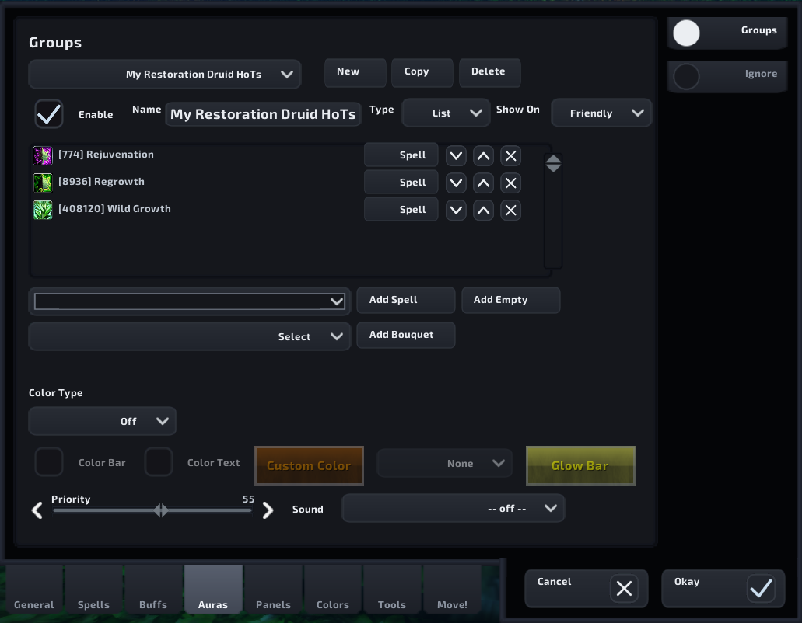

This is a copy of the default `Restoration Druid HoTs` Group in WoW Forever I've created using the "Copy Button". (This works the same in Retail, too.)

Above the spell list, to the right you can see the dropdowns for `Type` and `Scope`. `Type` switches the Aura Group between being a Filter-Type or List-Type Aura. `Scope` decides if this Aura Group and its colors, when anchored, should later be shown only on friendly units, hostile units, or on both. This is helpful on focus or target frames in PvP, for example.

Auras will show up on your Anchors in the order you pick here. The first spell in the list will show up in the first position of your anchor. 

You can reorder them using the arrow buttons in the list, or remove them using the X button.

Select a spell you'd like to add from the dropdown menu, or type in its name, then click `Add Spell` to add it to the list. `Add Empty` adds an empty space between Icons on your anchor, which can be useful for [Aura bars](#aura-bar-setup), for example. Additionally, you can add Bouquets from its respective dropdown.

In addition to this, you can see a `Spell` Button in each added Aura's row. This is used to control how individual icons show up.

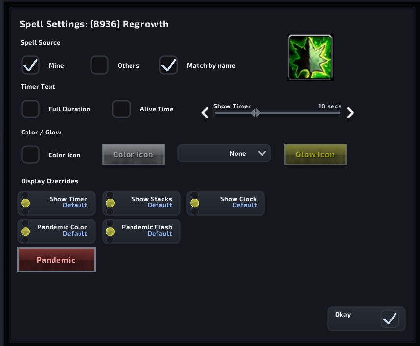

At the top, you can configure whether you'd like to see this aura when it's applied by you, others, or both. Because of spell ranks, in Forever, there's also a checkbox to always match an aura by name instead of Spell ID, so you don't have to change your Aura Groups every time you learn a new spell. It's checked by default, so you don't have to worry about it usually.

The `Timer Text` section lets you choose if you'd like to see the timer text for this Aura for its full duration, or have it count up instead of down. 

With the `Show Timer` slider, you control from which point on it starts counting down, if neither other option is selected.

You can also choose a color overlay to put on this Aura via `Color Icon`. This will be especially important for [Aura Bars](#aura-bar-setup) later, since it allows you to make different colored Aura Bars. You may also choose a `Glow Icon` effect to show around your icon and customize its color. You can preview both options on the icon as you go.

Below, under `Display Overrides` you can see overrides for the tri-state buttons in [Panels → Auras](#how-auras-get-displayed-panels--auras) and set up how you'd like your Aura icon to behave in its Pandemic window (at about 3-4 seconds left).
The color selection for the `Pandemic Color` allows you to override the default one set in [Colors → Auras](#global-defaults-colors--auras). 

### Filter-Type Auras

<!--ehh hier fehlt alles-->

 ### Bar Colors (Custom, Dispel, Glow)

 You can then set a **Color Type** for an Aura Group. The choices here are *Custom* and *Debuff*. Additionally, you can configure a bar glow, or a sound that plays, when any of the Auras in this Group are applied.

**Custom:** You may set a custom color for when **any** of the Auras in this Group are active on the player. You can click the example bar shown to change the Colors for both Text and the bar itself for this Aura Group. 
Coloring a bar, when, for example, specifically "Atonement" is on a bar is currently not possible.
 
**Dispel:** This uses the Colors configured under Colors>States. The best use for it is on a debuff-based Group, like "Relevant Debuffs".
 
Changing these Color settings applies the colors **regardless** of whether or not the Aura Group is anchored to any Panels (Anchors will be explained [here](#how-Auras-get-displayed-panels--Auras)). This is useful for when you want your frames to turn certain colors, but not show any icons.

The priority slider controls which Aura Group's color settings take precedence over other Aura Groups. The lower the number, the higher the priority.

Example:
- Aura Group 1 has debuff colors enabled and a priority of 50
- Aura Group 2 has custom colors enabled and a priority of 10

When Auras from both Groups are present, the custom color of Aura Group 2 takes priority
 
*Note that the main default Aura a lot of people will be using to track Debuffs, **"Dispellable Debuffs", already has its bar colors configured** to the "Dispel"-Colors, so **you won't need to do this manually.***
 
If you'd like the color settings of a built-in Group to not apply anymore, simply uncheck the "Enable" Box at the top of the Aura Group. This will also disable this group for selection in Panels → Auras. If you'd like to keep icons without colors, create a copy, disable colors for this copy and anchor it instead.

## How Auras get displayed: Panels → Auras

This is where you can configure which Aura Groups actually show up on your frames, and how.

These settings are per-panel, so to apply them to all of your panels, use the "apply all"-button on the bottom right. Otherwise, only your selected panel  will be impacted by the changes you make here. 

If you're not sure which panel is currently selected, you can see the Panel above the VuhDo Options, e.g. Panel #1. Additionally, if you look at the frames you've set up, each panel will have its label above it, e.g. PANEL 1. The currently selected one will be flashing. You can select a different panel by clicking its label.

<!--

 
 
-->

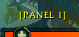
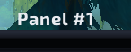

### Aura Icon Setup

Now for the settings. These look like a lot at first, so I'll go over them bit by bit.

<!--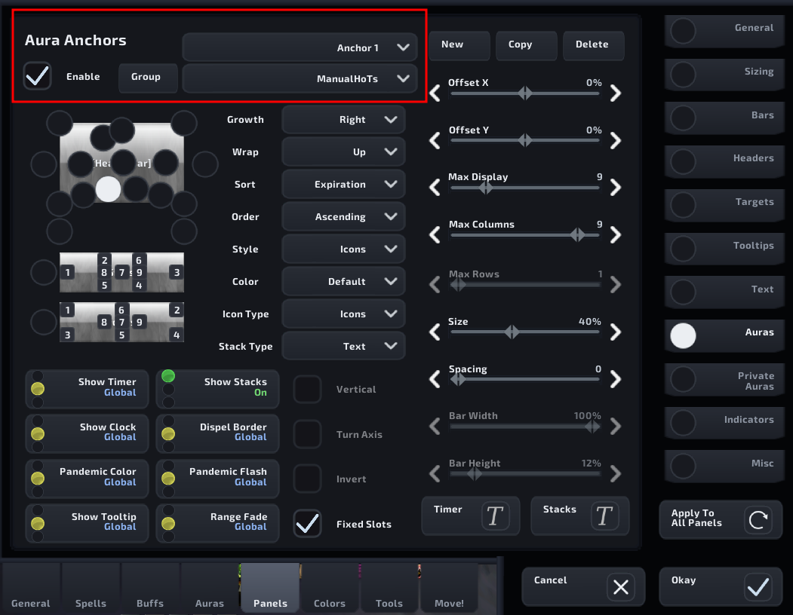-->

Here, you can enable or disable an anchor to toggle its icons showing. (Note that this doesn't affect debuff or custom colors.)

Use the Anchor Dropdown to choose which Anchor to work on. Each Anchor can hold one of your [Aura Groups](#which-auras-to-track-auras--groups). 

The Dropdown right below lets you choose which Aura Group to display on this Anchor, with the Group button taking you to the selected Aura Group's edit page.

<!--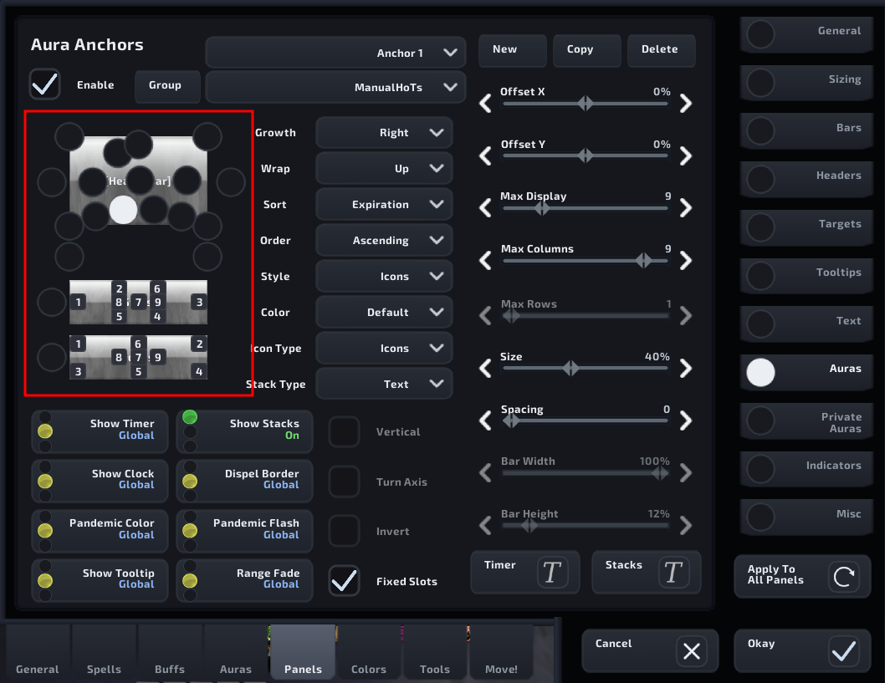-->

With these buttons, you can choose where the Aura Group on this anchor shows up.

If you pick a spot from the top example bar, your auras will show up in a line starting at that spot.

Choose one of the presets below it if you prefer a setup where each icon shows up in a different corner of your frames.

I recommend you never choose the same spot for two Anchors, as this will make them overlap.

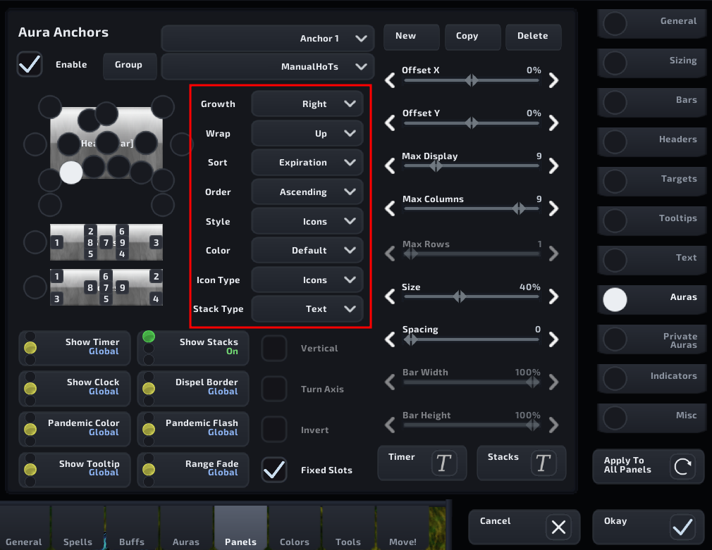

<!---->

These dropdown menus let you choose exactly how your icons are going to show up. Let's go over each one.

<u>Growth:</u> This decides, which direction the icons grow in, starting from the anchor point. I.e. when choosing "right", the second icon appears to the right of the first icon.

<u>Wrap:</u> Choose where icons should start again, once the number set with the "Max Columns"

<u>Sort:</u> Choose how a filter-type Aura Group's icons should be sorted.

<u>Order:</u> Choose whether the sorting order should be applied in ascending or descending order.

<u>Style:</u> Choose whether you'd like the Auras here to show up as icons or bars (similar to the old HoT bars). More about Aura Bars [here](#aura-bar-setup).

<u>Color:</u> Choose if Bar Colors (for Aura Bars) Should have their default color (set in Auras → Colors or [per spell](#filter-type-auras)<!--platzhalter bis das fertig ist, dann link ersetzen-->), dispel colors or class colors.

<u>Icon Type:</u> Use the default icon, a glossy or flat texture, or no icon at all (helpful for bars).

<u>Stack Type:</u> Choose if you want stacks to display as numbers or triangles.
<!-- Didn't Blizz break that? eh, whatever -->

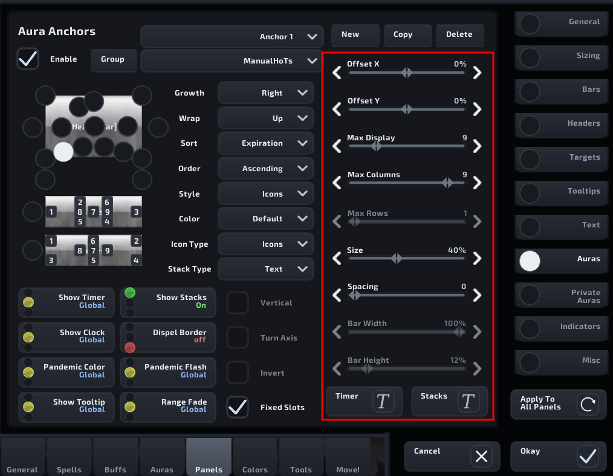

<!---->

Now for these sliders.

<u>Offset X:</u> Move the anchor point to the right and left, based on your chosen spot from the radio buttons.

<u>Offset Y:</u> Move the anchor point up and down, based on your chosen spot from the radio buttons.

<u>Max Display:</u> Choose how many Auras you want to display on this anchor. This can be helpful when you don't want to see a million debuffs on your frames in PvP.

<u>Max Columns:</u> Choose how many icons will be in one row before your "Wrap" setting kicks in.

<u>Max Rows:</u> If you're using one of the two non-linear Anchors, having more than 9 Auras on one of the anchors won't show all of them by default. Set this to 2 or higher if you'd like to see the 10th icon next to the first, the 11th next to the second, and so on.

<u>Size:</u> Controls the size of your icons. This is relative to the height of your frames, so 40% will equal 40% of the height of your health bar.

<u>Spacing:</u> Controls how much space there is in between icons.

<u>Bar Width/Height:</u> These will be discussed more [in the Aura Bar setup](#aura-bar-setup).

<u>Timer:</u> Customize the font, size and position of timers on your icons.

<u>Stacks:</u> Customize the font, size and position of stack counters (if Stack Type is set to text) on your icons.

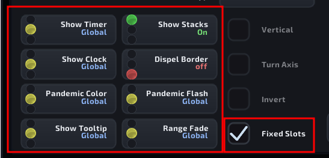

<!---->

These tri-state buttons are used to override the defaults set in [Colors -> Auras](#global-defaults-colors--auras) per-anchor. What they do is explained in that section. `Global` leaves them to the default set there, whereas `On` or `Off`overrdes this default.

Fixed Slots decides, whether icons stick to the spots they appear in on your frame, or collapse when one expires. To show what this means:

<u>Fixed Slots enabled:</u>

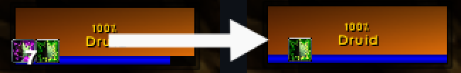

<u>Fixed Slots disabled:</u>

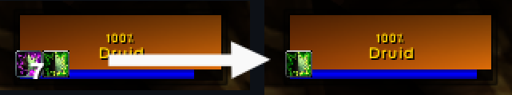

### Aura Bar Setup

As mentioned earlier, you can set an Anchor up to display all its Auras as bars.

To do this, choose `Bars` from the `Style`-Dropdown. 

If you want to configure only specific spells to show as bars, make a new anchor for them and create a [List-Type Aura Group](#list-type-auras-add-individual-auras) to anchor here.

Additionally, I recommend checking "Fixed Slots" for this Anchor, so as to not have bars jumping around on your frames.

<!--hier fehlen viele bilder-->

## Global Defaults: Colors → Auras

<!--hier fehlt noch fast alles-->

What's in these filters is taken care of by Blizzard. In Midnight, they work mostly as you'd expect. In Forever, a lot of things aren't really sorted into categories by Blizz, making debuff filtering a bit of a headache.

<u>Order of Precedence:</u>

Spell-specific settings you make within an aura group in Auras → Groups will take priority over the settings you make for an anchor in Panels → Auras. 

Any settings you make in Panels->Auras will take priority over Colors → Auras.

## What is that Panels → Private Auras tab?

A relic of worse times shaped by guess-based dispels. 

Jokes aside, the only things that show up on there as of S2 of Midnight are some fixates and the soak at the last boss of AoF. Make sure it's set to a reasonable size so you don't get jumpscared by giant fixate icons, or feel free to disable it outright.

What's on there for Forever? You tell me, lol.

## Common Setup Examples & Special Cases

These are some examples of groups/common setups for you to just copy the settings from. 

<!--wieso tu ich mir das an-->